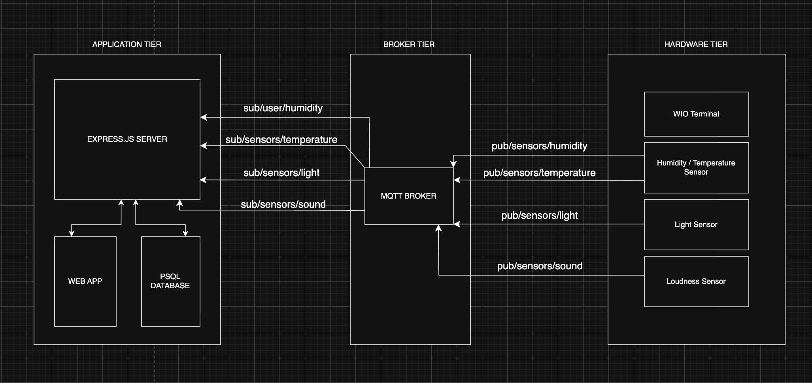

<details>
  <summary>Table of Contents</summary>
  <ol>
    <li>
      <a href="#about-circadian">About Circadian</a>
      <ul>
        <li><a href="#project-wiki">Project Wiki</a></li>
      </ul>
    </li>
    <li><a href="#system-architecture">System Architecture</a></li>
    <li>
      <a href="#getting-started">Getting Started</a>
      <ul>
        <li><a href="#prerequisites">Prerequisites</a></li>
        <li><a href="#installation">Installation</a></li>
        <li><a href="#setup">Setup</a></li>
      </ul>
    </li>
    <li><a href="#usage">Usage</a></li>
    <li><a href="#roadmap">Roadmap</a></li>
    <li><a href="#contributors">Contributors</a></li>
  </ol>
</details>

# About Circadian

It would not be unreasonable to say that sleep is the number one factor in human health, and the evidence that supports this claim is substantial. However, getting a good night's sleep goes far beyond just getting to bead earlier; it’s largely dependent on routines and environment. Factors such as light, temperature, and noise can greatly impact the quality of your sleep. Having deeper insights and more control over your environment will help set up the optimal sleep conditions for consistent restful nights.

The Circadian system tracks room conditions including light levels, temperature, humidity and noise of the users’ sleep environment. The system will provide real-time updates and suggestions on how to adjust their environment to be optimal for a chosen bedtime.

## Project Wiki

https://git.chalmers.se/courses/dit113/2026/group6/circadian/-/wikis/home

## Demo Video

_link to video here..._

## System Architecture

Below is a representation of how data will flow through the Circadian system. The Application tier and the Hardware tier are separated by a Broker tier. Within the Application tier data flows to the Web App (frontend/UI) and the Database via the server.



# Getting Started

For setting up and operating the system locally you will need to address the following:

## Prerequisites

Software:

- Arduino IDE (optional). Info at: https://docs.arduino.cc/software/ide/
- Node.js (v18+). Info at: https://nodejs.org/
- PostgreSQL (v18+). Info at: https://www.postgresql.org/
- HiveMQ Cloud. Info at: https://www.hivemq.com/

Hardware:

- Microcontroller (e.g. WIO Terminal)
- 101020736 / Grove - Light Sensor
- 101020011 / Grove - Temperature & Humidity Sensor (DHT11)
- 101020063 / Grove - Loudness Sensor
- Breadboard and connecting wires
- Power supply

## Installation

1. Clone the repository:

```
git clone https://git.chalmers.se/courses/dit113/2026/group6/circadian.git
```

2. Install dependencies:

```
cd backend
npm install
```

3. Install Arduino libraries:
   _ALL ARDUINO LIBRARIES_

## Setup

### Software Setup

1. Create an .env file in the /backend folder.
   Configure environment variables with your credentials as necessary:

```
PORT=3000

BROKER_URL='YOUR_HIVEMQ_URL'
BROKER_PORT=8883
MQTT_USERNAME='YOUR_HIVEMQ_USERNAME'
MQTT_PASSWORD='YOUR_HIVEMQ_PASSWORD'

DATABASE_URL=postgresql://localhost:5432/circadian
PGUSER=YOUR_POSTGRES_USERNAME
PGPASSWORD=YOUR_POSTGRES_USERNAME
PGHOST=localhost
PGPORT=5432
PGDATABASE=circadian
```

2. Set up PostgreSQL Database

```
psql -U postgres -c "CREATE DATABASE circadian;"
psql -U postgres -d circadian -f backend/db/schema.sql
```

_TODO: Make a arduino_secrets.h.example file_

3. Open arduino/arduino_secrets.h and update with your credentials:

```
#define WIFI_NAME "ADD_NETWORK_NAME"
#define WIFI_PASSWORD "ADD_WIFI_PASSWORD"
#define MQTT_URL "ADD_MQTT_URL"
#define MQTT_PORT 8883
#define MQTT_CLIENT_ID "WioTerminalClient"
#define MQTT_USERNAME "ADD_MQTT_USERNAME"
#define MQTT_PASSWORD "ADD_MQTT_PASSWORD!"
```

4. Open arduino/certs.h and paste in your HiveMQ Cloud TLS certificate using the following structure:

```
const char* hivemq_cert = R"EOF(
-----BEGIN CERTIFICATE-----
YOUR_TLS_CERTIFICATE_HERE
-----END CERTIFICATE-----
)EOF";
```

Info at: https://www.hivemq.com/blog/end-to-end-encryption-in-the-cloud/#heading-tls-java-keystores-and-truststores

### Hardware Setup

_add instructions for hardware here_

# User Manual

### Basic user creation and login

1. If first time using Circadian, navigate to the sign up page by clicking the 'sign up' button and fill in your details.

2. Login using your username and password.

3. You will be redirected to your landing page where you will be show live sensor readings and recommendations for your environment.

### Report Generation

1. Select a date from the report drop down menu on the landing page.

2. A report will be generated using your data from that day. Here you can see trends of your sleep environment from chosen days.

### Account Customization

1. Navigate to 'Settings' and chose your desired preferences.

2. These preferences will decide and adjust the optimal levels for the users sleep enviroment and send messages/recommendations based on these preferecnes.

# Roadmap

_add developement roadmap here_

# Contributors

- Herman Larsson
- Filip Andersson
- Kim Duso Joviken
- Dominic Wooldridge
